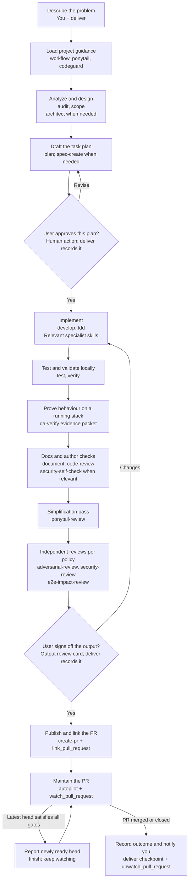
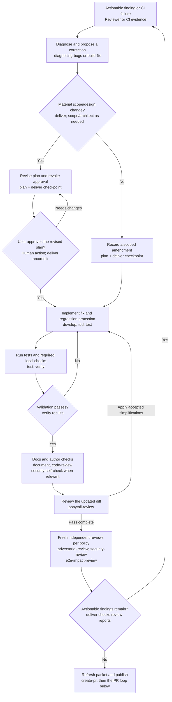
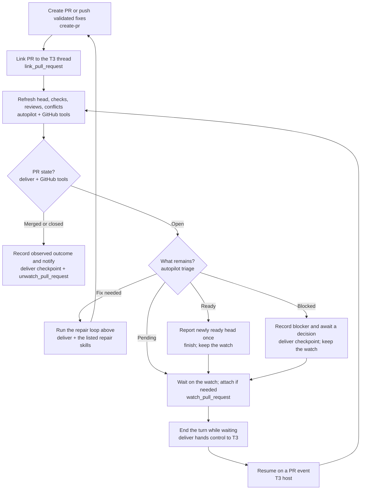

# Personal agent workflows

An approval-gated coding workflow for T3 Code. Start with a problem, review a
concrete plan, and then let the agent implement, test, obtain independent
reviews, open a PR, and maintain it through feedback and conflicts until it is
merged or closed. Passing CI reports readiness and keeps monitoring active.

**Fork changes (QA tailoring):** the user is involved at two gates only, plan
approval and output sign-off. A `qa-verify` stage proves behaviour on a running
stack and writes an evidence packet, replacing manual local re-testing. Output
sign-off of the current head is required before the first PR publication; later
in-scope repairs continue automatically. Both gates use fixed review cards.

This repository is personal tooling. Install it in your home directory; it adds
no workflow files, dependencies, or configuration to an application repository.

## What runs where

- `skills/deliver/SKILL.md` is the coordinator.
- T3 runs the agent/tools and resumes the thread on PR events.
- Bundled personal skills supply general engineering stages.
- The target project's own instructions, skills, hooks, review gates, and
  publishing scripts remain authoritative.
- Local checkpoints store progress and approval evidence. This is agent
  orchestration, not a separate daemon or a hard tool-authorization boundary.

The package uses Python 3.10+ and the standard library. Real coding tasks also
need their project toolchain, Git, authenticated GitHub access, and the relevant
T3 host tools. No API keys or credentials are included.

## Install on Ubuntu

```bash
git clone git@github.com:Saty248/agent-workflows.git ~/src/agent-workflows
cd ~/src/agent-workflows
python3 install.py
python3 install.py --check
```

The installer links skills into:
- `~/.agents/skills` for shared/Codex discovery;
- `~/.cursor/skills` for Cursor;
- `~/.claude/skills` for Claude.

For a narrower installation, use `--targets shared`, or a comma-separated
combination of `shared,codex,cursor,claude`. The optional `codex` target is
`$CODEX_HOME/skills` (normally `~/.codex/skills`); avoid installing duplicate
Codex entries unless your setup needs that location.

An existing unrelated `deliver` is a conflict and is never overwritten.
Existing personal dependency skills are preserved and reported. The coordinator
must read their actual installed instructions. New links point to this clone,
so keep it at a stable path. Start a fresh T3 provider session after installation
so its skill catalog refreshes. Run tasks in the application project, not here.

To update:

```bash
cd ~/src/agent-workflows
git pull --ff-only
python3 install.py
python3 install.py --check
```

To uninstall this package's links:

```bash
python3 install.py --uninstall
```

Uninstall only removes links whose targets belong to this clone. Existing skills
and local task checkpoints remain.

## Start a task

In a T3 conversation opened on your application checkout:

> Use deliver to plan: Fix duplicate notifications after a retry. Wait for my
> approval before implementing.

Review the plan, then reply:

> Approve this plan. Implement it, open the PR, and keep watching and fixing
> in-scope findings until the PR is merged or closed.

Approval must identify the current plan/scope. Routine repairs within that scope
continue automatically; material design/scope changes return for your approval.

For a planning-only trial:

> Use deliver in planning-only mode: Investigate slow search and draft a plan.
> Do not implement or publish anything.

For resume:

> Use deliver to resume task retry-fix in this checkout. Read its checkpoint and
> plan, refresh the PR state, and continue from the first unmet gate.

Explicit skill syntax such as `$deliver` or a slash menu depends on the provider
and T3 version. The plain-language invocation above is the portable starting
point. If deliver is absent from the refreshed catalog, give the installed
`~/.agents/skills/deliver/SKILL.md` path explicitly and inspect discovery.

## Workflow and skill routing

### Main workflow

The normal path starts with a problem and stops for approval of a specific plan.
The later diagrams expand the review and PR loops. `deliver` coordinates every
stage; each node names its supporting skills or tools. Approval is a human
action. Checkpoint actions use the helper bundled with `deliver`.



This overview shows the successful path. Failed checks, actionable findings,
scope changes, and external blockers follow the loops below. Planning-only mode
stops at the plan; it does not proceed to implementation or publication.
Project skills and review thresholds apply as described below. The functions
`link_pull_request`, `watch_pull_request`, and `unwatch_pull_request` are T3
tools, not separate skills.

1. Context and constraints: project `workflow`, `ponytail`, and `codeguard`.
2. Investigation and scope: `audit`, `scope`, and `architect` when needed.
3. Reviewable plan: project `plan`; `spec-create` for a new durable contract.
4. User approval: record the plan revision and actual approving user message.
5. Implementation: `develop`, project `tdd`, and relevant specialist guidance.
6. Behavior and local validation: `test` plus project `verify`, then
   `qa-verify` on a running stack with an evidence packet.
7. Docs and author checks: `document`, project `code-review`, and
   `security-self-check` when relevant, followed by `ponytail-review` before
   independent review.
8. Independent review: project `adversarial-review`, `security-review`, and
   `e2e-impact-review` under its policy. In SkyTrade's current policy,
   adversarial review applies at S1+ and separate security review at S2+.
9. Output sign-off: present the output review card; record the user's
   sign-off of the current head before the first publication.
10. Publish: project `create-pr`, including its review packet and wrapper.
11. Maintain until merged/closed: `autopilot` for triage plus T3's PR watcher.
12. Report readiness: `finish`, based on the latest head; keep watching.
13. Final handoff: `deliver` records a confirmed merge/closure and stops the watch.

Use the project's documented equivalents when a named skill is unavailable.
General skills never bypass project gates. The package bundles only `audit`,
`scope`, `architect`, `develop`, `test`, `qa-verify`, `document`, `autopilot`,
`finish`, and `ponytail-review`, plus `fix-ticket` (one-line ticket entry point)
and `pr-visual-evidence` (before/after screenshots in the PR description). It
does not vendor application-specific policies.

Specialists are selected by the actual change: Spring guidance for Java,
`jpa-patterns`/`database-migrations` for persistence, `plain-language` for copy,
`codebase-design` for boundaries, and relevant security/agent-writing guidance.
Read the coordinator's routing reference for the complete selection rules.

## Bugs, risks, and the repair loop

The same repair path handles findings before publication and problems discovered
by CI or reviewers after publication.



The simplification pass records findings and their dispositions. Accepted changes
return through validation before independent review. It preserves required
behavior, security controls, tests, coverage, and project gates; it does not
replace any independent complexity/debt assessment.

Use project `diagnosing-bugs` or `build-fix` for the relevant failure. A scoped
amendment invalidates downstream evidence. A material scope/design change revokes
approval until you approve the revised plan. Residual risks require an explicit
disposition under the project's policy.

The agent reads actual CI logs, review threads, and conflicts. Project-selected
checks run before commits, including repair commits. It never weakens tests or
gates to manufacture a green result.

After three unsuccessful repairs of the same cause without resolution, it
reports the evidence and asks for direction before retrying that cause. Missing
tools/access, external outages, and decisions requiring you pause dependent
fixes. The open PR remains watched while awaiting a decision or new evidence.
If the watcher itself is unavailable, the agent reports that limitation and
preserves progress rather than claiming monitoring is active.

Reviewer suggestions are checked against the actual code and approved scope.
Valid fixes use the complete repair loop; invalid or already-addressed comments
receive an evidence-backed explanation. The agent replies with the fix commit
or rationale and resolves threads when authorized. It integrates the latest
remote PR branch and base before resolving conflicts, preserves both branches'
intent, verifies the resolution, and pushes without force. Conflicting intent
or material scope changes return to you for a decision.

## Watching and completion

T3's `watch_pull_request` resumes the parent on failed checks, required-check
completion, reviews/comments, or conflicts. The agent ends its turn while
waiting. It uses no polling daemon, shell wait loop, or recurring scheduled task.
Honor any host/project lifecycle rules that supersede this reference.

A wake alone is not success. Read the PR state first; a confirmed merge or
closure ends maintenance before further edits. For an open PR, re-read its
latest head, checks, reviews, unresolved threads, and mergeability. Project
AI-review holds may intentionally cancel CI until external reviews pass.



Triage conflicts first, then active review comments, then failing CI. The watch
persists across wakes and pushes, so the waiting loop reuses it. A wake about
green checks still returns through the live-state check; results for an older
commit do not complete the task.

Pending includes running checks, required reviews, and intentional AI-review
holds. Blocked includes a decision needed from you, missing access, or the repair
retry limit. Ready requires all readiness gates for the latest pushed head and
is still an active monitoring state.

The agent reports each newly ready head/state once, then keeps watching for
late suggestions, CI failures, and conflicts. It repeats verification and
required reviews after repairs and pushes the validated update. A green PR is
not the end of the task. Human approvals and merging remain human work.

Maintenance finishes only after a fresh read confirms merged or closed, or you
explicitly stop or hand off the task. Merged and closed-without-merge outcomes
are reported distinctly; closed PRs are not automatically reopened. The agent
records the outcome and stops its watch before terminal handoff. It does not
merge, enable auto-merge, deploy, or change draft status without a separate
explicit request.

The watcher depends on the T3 host remaining available. A laptop that is offline
cannot process events. Skill Git sync does not migrate sessions, credentials,
approvals, or watches. A live task needs an explicit single-owner handoff before
another laptop takes over.

## Checkpoints

State is under `$XDG_STATE_HOME/agent-workflows`, defaulting to
`~/.local/state/agent-workflows`. Each checkout and task have a separate record.
The record contains the plan path/hash, approval reference, phase, history, PR,
and last recorded head. An approved-plan snapshot preserves the reviewed text.

The helper rejects an unapproved implementation transition or an unrecorded plan
edit. It serializes local checkpoint writes and writes files atomically.
The model still owns scope judgement and the authenticity of cited approval.
A checkpoint is not proof that CI ran or an independent reviewer approved.
`ready` remains repairable and monitored. A `complete` command records a freshly
observed merged/closed outcome with the remote PR head and evidence. Terminal
checkpoints reject further mutations; they do not depend on the local checkout
having caught up with the PR.

Project-required plans still go in the project's mandated location and may be
part of a real task PR. The personal workflow definitions and runtime checkpoint
stay outside the application repository.

## Validation

```bash
python3 -m unittest discover -s tests -v
python3 install.py --check
```

Tests exercise approval invalidation, repair transitions, private checkpoint
storage, ready-to-repair transitions, merged/closed outcomes, installer conflicts,
idempotence, uninstall, and shell-safe paths.
No application services or Docker containers are started.
